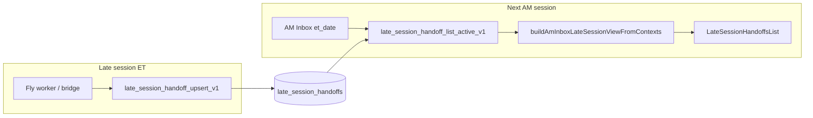

# Batch 175 — Continuation & AM Inbox acceptance V1

**Depends on:** Batch **174** live-session evidence (partial — see `monday-scanner-acceptance-2026-10-26.md`).  
**Git baseline:** **`13a018a9`**. No new scanner engine in this batch.  
**Tuesday production pass:** `docs/release/batch175-tuesday-production-acceptance-2026-10-27.md`.

## Intended workflow (canonical)

**Session labeling:** `resolveLateSessionExpiryState` — most categories active only when `amSessionDate === nextTradingDay(sourceSessionDate)`. **Monday captures appear Tuesday AM Inbox**, not Monday late evening (by design).

## Acceptance criteria

| # | Criterion | Status (2026-10-26) | Evidence |
| --- | --- | --- | --- |
| 1 | Worker persists qualified late-session captures | **PASS (inferred)** | 2026-10-26 rows present; `source_timestamp` ~21:11 UTC cluster (see Tuesday acceptance doc) |
| 2 | RPC returns active rows for target `p_am_session_date` | **PASS** | Lovable Oct 27: **3,131** rows (`2026-10-27`); **2,272** Monday `2026-10-26` source; **859** Fri Day-Two |
| 3 | Categories labeled (Power Hour, AH, HOD, Day-Two) | **PASS (regression)** | `LateSessionHandoffsList` + batch12 view tests |
| 4 | Qualified fallback when priority pool empty | **PASS (regression)** | `am-inbox-late-session-funnel.test.ts`, `am-inbox-default-list-regression.test.ts` |
| 5 | Expired captures omitted | **PASS (regression)** | `late-session-expiry` + batch12 |
| 6 | Security/symbol identity on handoff | **PASS (regression)** | Batch **173** + `late-session-workflow-handoff.test.ts` |
| 7 | Morning board merges continuation symbols | **PASS (code review)** | `AMInbox.tsx` `collectMorningBoardEnrichmentSymbols` |
| 8 | Prior-session copy (“not live market activity”) | **NOT VERIFIED (UI)** | HandoffCard contract in git; login required for live check |
| 9 | Large payload client processing / loading lifecycle | **CONDITIONAL** | Batch **186** code + tests; UI **NOT VERIFIED** |

## Completed vs remaining

| Completed on `main` | Remaining for sign-off |
| --- | --- |
| Client funnel, collapse, priority scoring, qualified fallback UI | **Authenticated AM Inbox** on **2026-10-27** premarket |
| RPC list/upsert/expire in migrations | **Done** — read-only RPC probe 2026-10-26 ET |
| Bridge action `late_session_handoff_upsert` | **Inferred PASS** from persisted Monday rows + timestamps |
| Continuation RVOL baseline propagation (warning **#8**) | Live label spot-check on AM Inbox cards |

## Blockers

- **No production Postgres read** from this workspace (Lovable Cloud only for prod queries).
- **AM Inbox** requires authenticated Pro session for full UI acceptance.

## Penny Continuation (out of scope)

Penny **price-band** Radar panel ≠ Penny **Continuation** product. No separate handoff pipeline exists for sub-$1 continuation-only candidates. See `batch174-175-monday-acceptance-inbox-v1.md`.

## Follow-up implementation batch (if needed)

| Trigger | Batch |
| --- | --- |
| RPC returns rows but UI empty/wrong date | Bugfix: `amSessionDate` / expiry wiring |
| Worker never upserts during RTH late window | Ops: bridge/worker deploy parity (not Cursor migrations without approval) |
| Product requires Penny Continuation engine | **New batch** — spec + worker + panel distinct from `penny` price filter |
